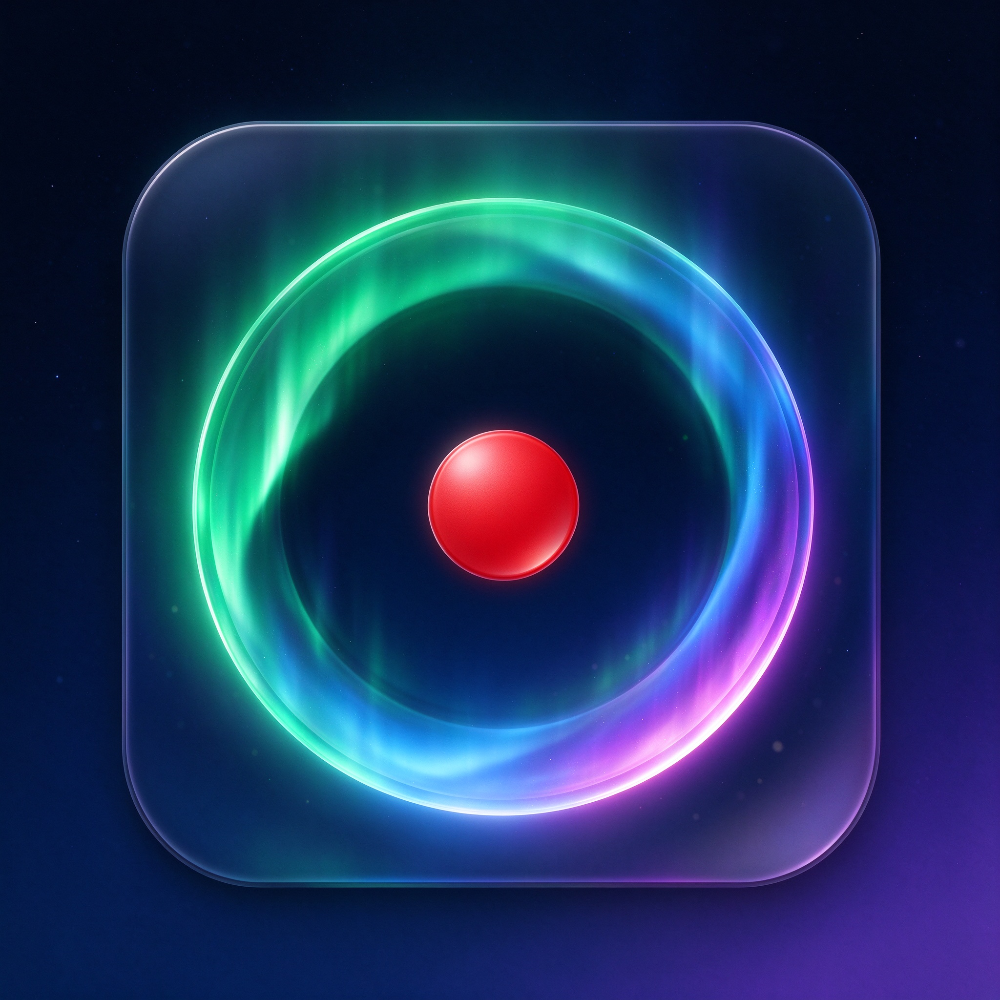
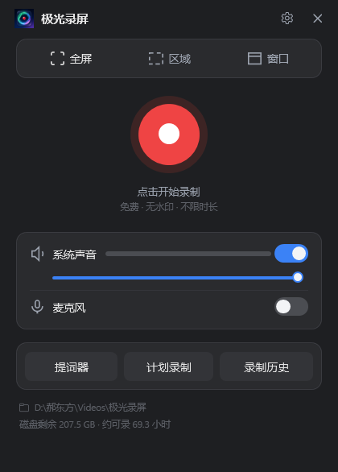
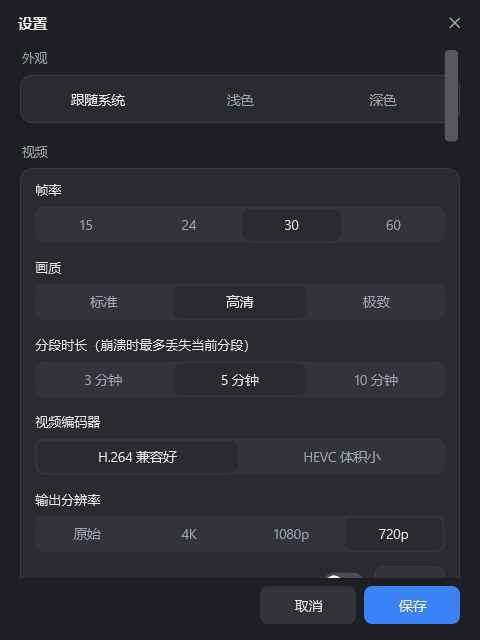
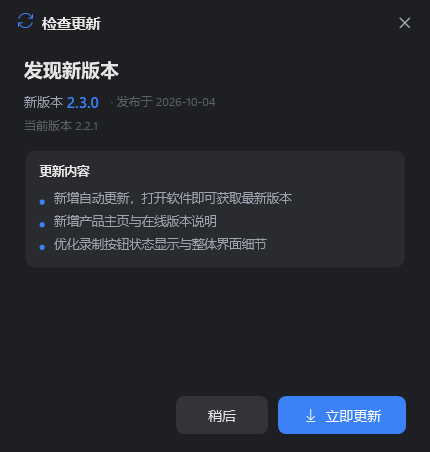

  

<h1 align="center">极光录屏 AuroraRecorder</h1>

  简洁好用的 Windows 桌面录屏工具 · 免费 · 无水印 · 不限时长

  <a href="https://github.com/haoeastspeed/AuroraRecorder/releases/latest"><b>⬇ 立即下载最新版</b></a> &nbsp;|&nbsp;
  <a href="https://haoeastspeed.github.io/AuroraRecorder/">🌐 产品主页</a>

---

  

## ✨ 产品简介

**极光录屏**是一款面向 Windows 的轻量级桌面录屏软件。它没有繁杂的菜单与层层弹窗，打开即可选择范围、一键录制；同时把硬件编码、声音混音、画面特效、提词器、AI 字幕等专业能力做得简单顺手。

- 💸 **完全免费**：无需注册、无功能限制、成片无水印、录制不限时长
- 🎬 **多种录制范围**：全屏 / 自定义区域 / 指定窗口，框选即录
- 🔊 **声音同步收录**：系统声音与麦克风同时采集，独立调音、实时混音
- ⚡ **硬件加速编码**：调用显卡硬件编码器输出 H.264 / HEVC，流畅且体积小
- 🛡️ **分段录制 · 崩溃恢复**：分段无缝写入，意外崩溃也只损失最后一小段，可自动恢复合并
- 🖱️ **画面特效**：按键可视化、鼠标聚光灯、点击高亮、步骤编号、自定义水印
- 📜 **提词器**：半透明提词窗滚动，且自动排除在录制画面之外
- ⏰ **计划录制**：定时开始、到时停止，无人值守
- 🎥 **摄像头画中画**：可调形状 / 位置 / 大小，支持绿 / 蓝幕色度键抠像
- 📝 **AI 字幕 · 智能降噪**：本地语音识别导出 SRT 字幕，多重算法抑制环境杂音
- 🔄 **自动更新**：启动后台静默检查，新版本一键下载、校验并应用

## 🖼️ 界面预览

  
  
  

## ⬇️ 下载与安装

1. 前往 [**最新发布页**](https://github.com/haoeastspeed/AuroraRecorder/releases/latest)
2. 下载 `极光录屏.exe`（单文件，约 74 MB）
3. 双击即可运行，**无需安装**；可放到任意目录，建议右键“发送到 → 桌面快捷方式”

> 首次运行若出现 Windows SmartScreen“已保护你的电脑”提示，是因为软件暂未购买代码签名证书。点击 **“更多信息” → “仍要运行”** 即可，文件安全无毒。

## 🚀 快速开始

1. 打开软件，顶部选择录制范围：**全屏 / 区域 / 窗口**
2. 在下方开启并调节 **系统声音**、**麦克风** 音量
3. 点击中央红色录制按钮（或按热键）开始；录制中主界面自动隐藏，仅显示不进画面的悬浮小控件
4. 点击悬浮控件的停止按钮结束，随后可在预览窗口中 **播放、裁剪、转 GIF、抽帧或打开所在目录**

## ⌨️ 快捷键（可在设置中自定义，重启后生效）

| 功能 | 默认操作 |
| --- | --- |
| 开始录制 | 可在「设置 → 全局热键」中自定义 |
| 暂停 / 继续 | 可在设置中自定义 |
| 停止录制 | 可在设置中自定义 |

## 🔄 自动更新

软件启动后会在后台安静地检查新版本（可在「设置」中关闭）。发现更新时才弹出提示，支持：

- 流式下载并实时显示进度
- **SHA-256 完整性校验**，确认文件未被篡改
- 一键应用，自动关闭旧版本、替换文件并重启，全程无黑窗

更新清单托管于 GitHub Releases（`latest.json`），软件默认跟随系统代理访问网络；检查失败会被静默忽略，不影响正常使用。

## 💻 系统要求

- **操作系统**：Windows 10 版本 1903（19041）及以上，推荐 Windows 10 / 11 64 位
- **显卡**：支持硬件编码的 Intel 核显 / NVIDIA / AMD 显卡（无独显时自动回退，仍可录制）
- **磁盘**：建议预留数 GB 可用空间，软件会实时显示可录制时长
- **网络**：仅在下载、自动更新、按需下载 AI 模型时需要

## ❓ 常见问题

**Q：录制的视频保存在哪里？**
A：默认保存在「视频库 \ 极光录屏」文件夹，可在「设置 → 存储位置」中修改；主界面底部也会显示当前路径。

**Q：会录制到软件自身的界面吗？**
A：不会。录制开始时主界面会自动隐藏，悬浮小控件也通过系统接口排除在捕获画面之外。

**Q：摄像头画中画 / 色度键如何使用？**
A：在「设置 → 摄像头」中开启并选择设备、形状、位置与大小；色度键可选择绿 / 蓝幕并指定替换背景。

**Q：AI 字幕是在线识别吗？**
A：字幕在本地运行（首次使用会自动下载约 75 MB 的语音模型），不会上传你的录音或视频。

## 📄 说明

本软件免费提供，欢迎下载、使用与推荐。如在使用中遇到问题，欢迎提交 [Issues](https://github.com/haoeastspeed/AuroraRecorder/issues) 反馈。

- 产品主页：https://haoeastspeed.github.io/AuroraRecorder/
- 发布下载：https://github.com/haoeastspeed/AuroraRecorder/releases
